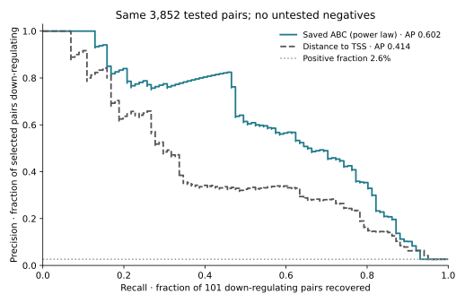
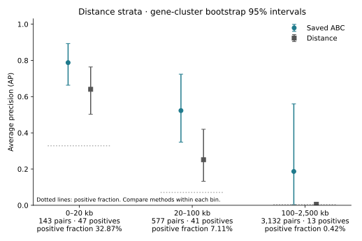
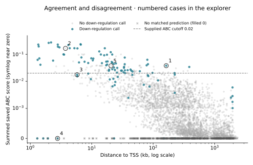

# Results and limits

## Main result

The independently implemented Python cohort matches the original R routines for
all 3,852 evaluated pair IDs, original labels, aggregated scores, distances and
coverage flags. No model was trained. No experimental labels were changed.

| Same-pair comparison | Pairs / positives | ABC AP | Distance AP | Paired AP difference, 95% gene-bootstrap interval |
| --- | ---: | ---: | ---: | ---: |
| All valid tested pairs | 3,852 / 101 | 0.602 | 0.414 | +0.188 [0.074, 0.296] |
| 0–20 kb | 143 / 47 | 0.788 | 0.640 | +0.147 [−0.012, 0.313] |
| 20–100 kb | 577 / 41 | 0.523 | 0.251 | +0.271 [0.098, 0.441] |
| 100–2,500 kb | 3,132 / 13 | 0.187 | 0.006 | +0.181 [−0.001, 0.554] |
| Covered-only sensitivity | 3,331 / 94 | 0.644 | 0.407 | +0.237 [0.141, 0.327] |

Ranges include their lower and exclude their upper bounds. Positive fractions
are 32.87%, 7.11% and 0.42% in the three distance bins: **compare the methods
within a bin, not AP levels across bins as if the tasks had equal difficulty.**
ABC's point estimate is higher in every bin, but the near and far-bin paired
intervals include zero. This is not evidence of a confidently resolved advantage
in every distance range.

Intervals are percentile intervals from 2,000 seeded, paired **target-gene cluster**
resamples, with all pairs for a sampled gene retained with that multiplicity.
Genes present in each cohort/bin are resampled within that analysis. The far-bin
analysis had 13/2,000 resamples with no positive labels; AP is undefined there,
and its interval uses the remaining 1,987 draws. The covered far-bin analysis uses
1,980/2,000. These are conditional descriptive intervals, not calibrated evidence
of generalization. Shared elements and studies remain additional dependence.

## Original example versus added analysis

The original report's functions give **AUPRC 0.588235 (ABC) and 0.401794 (distance)**.
That code uses trapezoidal integration and its own endpoint removal. It is not
the average precision used above. We preserve its output, rather than silently
changing the metric to make reproduction look identical. The R numerical report
uses 1,000 pair-level bootstrap replicates; these are not the gene-cluster
intervals above. See `results/official/performance_summary.tsv` and
[the original-code reproduction note](docs/official-reproduction.md).

The addition here is the same-pair distance-stratified analysis, missingness audit,
gene-cluster uncertainty, interactive evidence inspection and transparent case
selection. **This is a reproduction and focused reanalysis of a published benchmark,
not independent validation of ABC.**

## Coverage and data alignment

- 5,091 source experiments → 3,852 valid evaluated pairs. The 1,239 excluded rows
  retain their source invalid-connection or missing-gene reasons in `excluded_rows.csv`.
  Four rows lack a supplied gene-universe entry; all four were already invalid.
- 55,039 saved predictions → 44,433 after removing TSS-overlapping elements.
- 521 evaluated pairs lack a matching eligible prediction: 494 were absent before
  TSS filtering, and 27 additional negative pairs lose coverage through that filter.
  **Seven experimentally positive pairs are among the 521.**
- The primary evaluation fills these scores with zero, exactly as configured.
  Coverage-only sensitivity excludes those same pairs from **both** methods.
  Its higher ABC AP does not mean filtering improved the model: the target cohort changed.
- All 3,852 row names embed historical coordinates different from their actual
  GRCh38 columns. Original experiment TSSs also differ from the supplied universe
  for 53/54 genes. We use the supplied annotation and explicit coordinate columns;
  all 54 annotation TSSs agree with saved prediction TSSs.
- Predictions have no usable Ensembl IDs or supplied `DistanceToTSS` values.
  Exact gene symbols, mapped K562 identity, chromosome and interval overlap define
  the join; no guessed aliases or lifted-over row-name coordinates are used.
- Original inclusive overlap versus canonical half-open BED overlap makes **zero
  matching differences** on this example. Using absolute midpoint distance instead
  of upstream intervening-base distance changes distances by ≤1.5 bp and leaves
  distance AP unchanged.
- All original `Regulated` labels are preserved. The 3,751 nonpositive rows include
  **31 significant expression increases**. Calling all of these “no effect” is wrong.
  Only two nonpositive rows have reported power below 0.8 at a 25% effect; that power
  does not establish sensitivity to all smaller effects or remove study differences.

## Five illustrative cases

Selection rules are fixed in code and exported alongside each example; these are
deliberately informative examples, not a representative random sample. Coordinates
below are explicit GRCh38 interval columns. “High” means the supplied ABC score
threshold ≥0.02, not a tuned threshold or a probability of regulation.

| Case | Tested interval / distance | Saved ABC | Experiment | Why inspect it? |
| --- | --- | ---: | --- | --- |
| MYC | chr8:127898896–127898963 / 162.9 kb | 0.037811 | Down call; effect −0.359; adjusted p=2.44×10⁻¹¹ | A distal positive retained by ABC despite distance penalty |
| DNASE2 | chr19:12885011–12885511 / 3.7 kb | 0.165180 | No down call; effect −0.041; adjusted p=0.474 | High score and high reported power, but not a detected down-effect |
| FTL | chr19:48970828–48971348 / 5.8 kb | 0.017555 | Down call; effect −0.110; adjusted p=3.20×10⁻⁷ | Nearby positive just below the fixed ABC threshold |
| NFE2 | chr12:54303561–54304061 / 2.8 kb | Missing → 0 | Down call; effect −0.606; adjusted p=1.72×10⁻²⁶ | Coverage failure must be distinguished from a low measured score |
| COPZ1 | chr12:54304241–54304761 / 20.6 kb | 0.037379 | Significant **increase**; effect +0.083; adjusted p=0.00427 | Negative for this directional benchmark, not biologically inert |

The source effect-size units are retained without assuming cross-study
comparability. All five selected examples happen to be from Fulco2019; the full
evaluated cohort contains ten named study sources.

At 0.02, ABC selects 143 pairs: 70 down-calls and 73 non-down-calls, giving
precision 0.490 and recall 0.693. It misses 31/101 down-calls at this threshold.
The distance method is evaluated as a continuous ranking, **not** assigned an
arbitrarily optimized binary cutoff for the case descriptions.

## Limitations and one follow-up question

This is a small, selected K562 cancer-cell-line example associated with historical
ABC benchmarking—not a held-out sample, new experiment, general human-genome
evaluation, or comparison with the lab's current rE2G/scE2G models. The provided
score uses a power-law contact approximation; distance is already part of its
construction, so the comparison does not isolate measured 3D contact information.
Different assays, guides, power, gene activity and shared regulatory elements can
affect disagreements. Neither AP nor a high score proves a mechanism.

**Follow-up:** does the within-distance ranking advantage persist on a separate,
pre-specified CRISPR perturbation dataset with adequate prediction coverage and
comparable assay power? Freeze the candidate set, genome/ID matching and metric
definitions before inspecting those outcomes. If suitable independent data are
unavailable, call the next analysis another sensitivity check—not validation.
